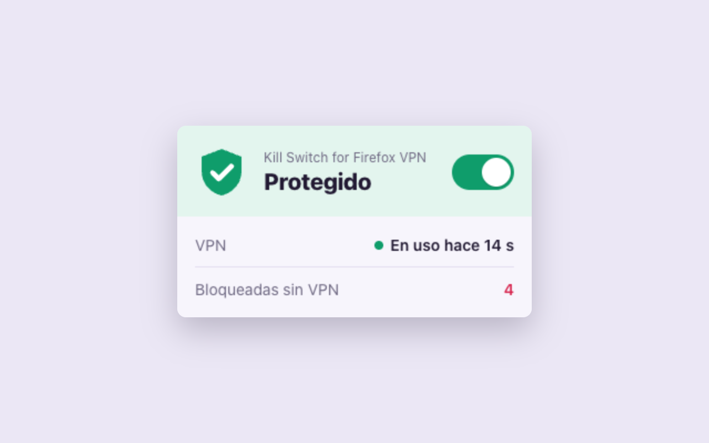
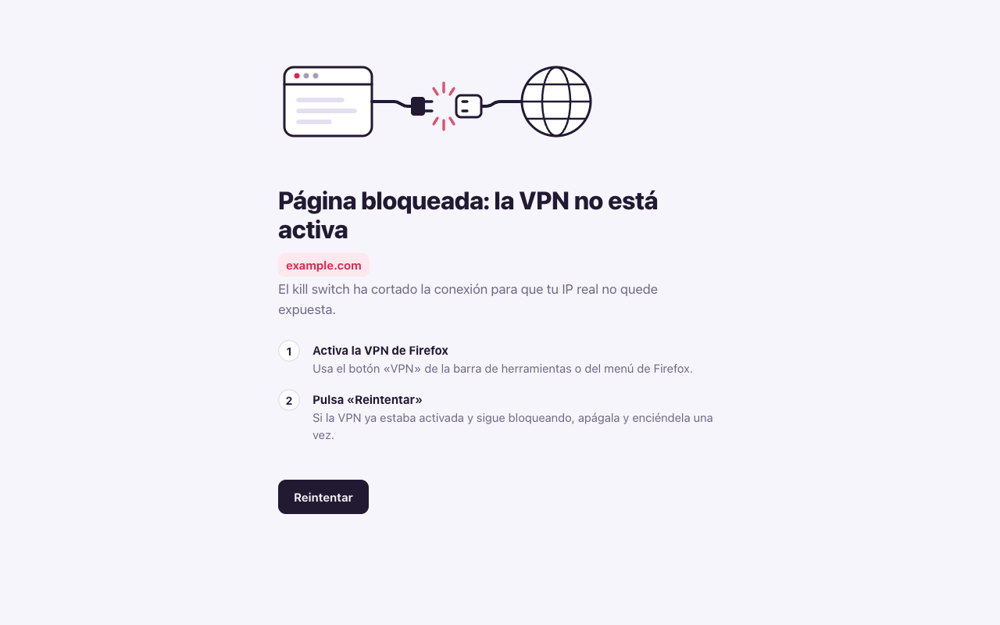

<p align="center">
  
</p>

<h1 align="center">Kill Switch for Firefox VPN</h1>

<p align="center">
  Bloquea toda página que no pase por la VPN integrada de Firefox, para que tu IP real no se filtre cuando la VPN se apaga.<br>
  Firefox para escritorio y Android · <a href="README.md">Read in English</a>
</p>

<p align="center">
  
</p>

## Para qué sirve

Firefox incluye una VPN gratuita (desde Firefox 149). Solo protege mientras está encendida. Si se apaga porque llegas al límite mensual de datos, cierras sesión, hay un error de red o la desactivas sin querer, Firefox sigue navegando con tu IP real y no te avisa.

Esta extensión es un kill switch: con ella activada, las páginas solo cargan a través de la VPN. Sin VPN, no cargan.

<p align="center">
  
</p>

## Funciones

- **Un solo interruptor.** Se activa o desactiva desde el botón de la barra (en Android, desde el menú de extensiones).
- **Bloquea antes de que nada salga del navegador**, incluida la consulta DNS.
- **Cierra WebRTC y el prefetch de DNS** mientras está activada. Ninguno de los dos pasa por la VPN, así que cualquiera podría revelar tu IP.
- **Nunca bloquea** tu red local ni los servicios de Mozilla que la VPN necesita para conectarse.
- **No recoge datos ni carga código remoto.** Son unos pocos kilobytes de JavaScript sin dependencias.
- En inglés y en español.

## Instalación

- **Complementos de Firefox:** próximamente.
- **Desde el código (temporal, para pruebas):** abre `about:debugging#/runtime/this-firefox`, pulsa **Cargar complemento temporal…** y elige `extension/manifest.json`. Firefox la quita al reiniciarse.

Después de instalarla:

1. **Si la VPN ya estaba encendida, apágala y enciéndela una vez.** Así la VPN queda por delante del kill switch (ver [limitaciones](#limitaciones)).
2. **Permite la extensión en ventanas privadas:** Complementos → Kill Switch for Firefox VPN → **Ejecutar en ventanas privadas**. Sin ese permiso, las ventanas privadas no están protegidas. El popup avisa si falta.

## Cómo funciona

La VPN integrada de Firefox no es una VPN del sistema. Es un proxy dentro del motor del navegador. Cuando la VPN se enciende, Firefox registra un filtro de proxy que envía cada petición por los servidores VPN de Mozilla. Cuando se apaga, Firefox quita ese filtro y las peticiones salen directas.

La extensión registra su propio filtro de proxy con `proxy.onRequest`. Ese filtro manda cada petición a un proxy inexistente en `127.0.0.1` (un "agujero negro"). Firefox aplica los filtros en orden de registro, y la VPN registra el suyo cada vez que se enciende, así que su filtro se ejecuta después del kill switch y sustituye el agujero negro por el servidor VPN real. Con la VPN apagada nada lo sustituye, y la petición falla dentro del navegador, antes de cualquier consulta DNS o conexión.

El análisis completo, con referencias al código fuente de Firefox, está en [docs/how-it-works.md](docs/how-it-works.md) (en inglés).

## Limitaciones

- **Ventanas privadas:** solo están protegidas si permites la extensión en ellas.
- **Instalada o actualizada con la VPN encendida:** el filtro de la VPN queda antes que el de la extensión, y se bloquean todas las páginas hasta que apagas y enciendes la VPN una vez. Nunca hay fuga: falla cerrado.
- **Las peticiones internas de Firefox** (actualizaciones, ajustes remotos) pueden pasar a conexión directa si su proxy falla. Tu navegación no se ve afectada.
- No cambies `network.proxy.retry_failed_proxies` a `false` en `about:config`.

## Desarrollo

Requisitos: Node.js 18+, Firefox 149+ y Python 3 con Selenium para las pruebas de extremo a extremo.

```sh
npm install
npm start              # ejecutar en un perfil temporal de Firefox
npm run start:android  # ejecutar en Firefox para Android (adb + Firefox Nightly)
npm run lint
npm run build          # zip para addons.mozilla.org, se guarda en web-ext-artifacts/
```

Las pruebas de extremo a extremo usan un Firefox real sin interfaz. Una extensión que simula la VPN manda el tráfico a un proxy local, y las pruebas comprueban seis casos: VPN encendida, VPN que se cae, orden de filtros incorrecto y un archivo PAC con `DIRECT` de respaldo.

```sh
python3 -m venv .venv && .venv/bin/pip install -r tests/requirements.txt
.venv/bin/python tests/e2e.py
```

La estructura del proyecto y cómo añadir traducciones están en [CONTRIBUTING.md](CONTRIBUTING.md).

## Privacidad

La extensión no recoge, guarda ni envía ningún dato. Ver [PRIVACY.md](PRIVACY.md).

## Licencia

[MIT](LICENSE). Este proyecto no está afiliado a Mozilla ni cuenta con su respaldo. Firefox es una marca registrada de la Mozilla Foundation.
