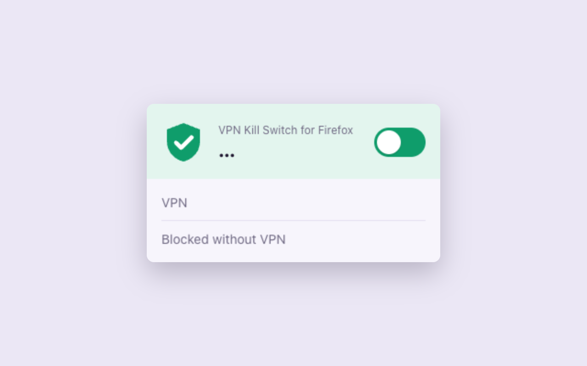
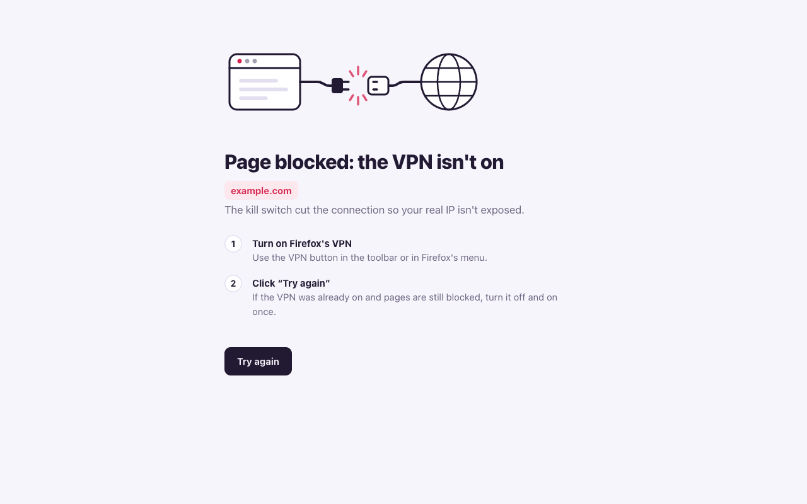

<p align="center">
  
</p>

<h1 align="center">VPN Kill Switch for Firefox</h1>

<p align="center">
  Blocks every page that doesn't go through Firefox's built-in VPN, so your real IP doesn't leak when the VPN turns off.<br>
  Firefox for desktop and Android · <a href="README.es.md">Leer en español</a>
</p>

<p align="center">
  
</p>

## Why

Firefox includes a free VPN (Firefox 149 and later). It protects only while it's on. If it turns off because you hit the monthly data limit, sign out, have a network error or switch it off by accident, Firefox keeps browsing with your real IP and doesn't warn you.

This extension is a kill switch: with it on, pages only load through the VPN. Without the VPN, they don't load at all.

<p align="center">
  
</p>

## Features

- **One switch.** On or off from the toolbar button (on Android, in the extensions menu).
- **Blocks before anything leaves the browser**, including the DNS lookup.
- **Closes WebRTC and DNS prefetching** while it's on. Neither goes through the VPN, so either could reveal your IP.
- **Never blocks** your local network or the Mozilla services the VPN needs to connect.
- **Collects no data and has no remote code.** It's a few kilobytes of plain JavaScript.
- English and Spanish.

## Install

- **GitHub (signed by Mozilla):** download the `.xpi` from the [latest release](https://github.com/agsola/firefox-vpn-kill-switch-extension/releases/latest) and open it with Firefox. On Android, open the file from Firefox's downloads.
- **Firefox Add-ons:** coming soon.
- **From source (temporary, for testing):** open `about:debugging#/runtime/this-firefox`, click **Load Temporary Add-on…** and select `extension/manifest.json`. Firefox removes it when it restarts.

After installing:

1. **If the VPN was already on, turn it off and on once.** This puts the VPN ahead of the kill switch (see [limitations](#limitations)).
2. **Allow the extension in private windows:** Add-ons → VPN Kill Switch for Firefox → **Run in Private Windows**. Without it, private windows aren't protected. The popup warns you when this is missing.

## How it works

Firefox's built-in VPN isn't a system VPN. It's a proxy inside the browser engine. When the VPN turns on, Firefox registers a proxy filter that routes each request through Mozilla's VPN servers. When the VPN turns off, Firefox removes that filter and requests go out directly.

The extension registers its own proxy filter with `proxy.onRequest`. That filter sends every request to a dead proxy on `127.0.0.1` (a "black hole"). Firefox runs filters in registration order, and the VPN registers its filter each time it turns on, so the VPN's filter runs after the kill switch and replaces the black hole with the real VPN server. With the VPN off, nothing replaces it, and the request fails inside the browser, before any DNS lookup or connection.

The full analysis, with references to Firefox's source code, is in [docs/how-it-works.md](docs/how-it-works.md).

## Limitations

- **Private windows** are protected only if you allow the extension there.
- **Installed or updated while the VPN is on:** the VPN's filter ends up before the extension's, and every page is blocked until you turn the VPN off and on once. It never leaks; it fails closed.
- **Firefox's own background requests** (updates, remote settings) can fall back to a direct connection when their proxy fails. Your browsing is not affected.
- Don't set `network.proxy.retry_failed_proxies` to `false` in `about:config`.

## Development

Requirements: Node.js 18+, Firefox 149+, and Python 3 with Selenium for the end-to-end tests.

```sh
npm install
npm start              # run in a temporary Firefox profile
npm run start:android  # run on Firefox for Android (adb + Firefox Nightly)
npm run lint
npm run build          # zip for addons.mozilla.org, saved to web-ext-artifacts/
```

End-to-end tests run a real headless Firefox. A fake VPN extension sends traffic to a local proxy, and the tests check six cases: VPN on, VPN drops, wrong filter order, and a PAC file with a `DIRECT` fallback.

```sh
python3 -m venv .venv && .venv/bin/pip install -r tests/requirements.txt
.venv/bin/python tests/e2e.py
```

See [CONTRIBUTING.md](CONTRIBUTING.md) for the project layout and translations.

## Privacy

The extension doesn't collect, store or send any data. See [PRIVACY.md](PRIVACY.md).

## License

[MIT](LICENSE). This project isn't affiliated with or endorsed by Mozilla. Firefox is a trademark of the Mozilla Foundation.
